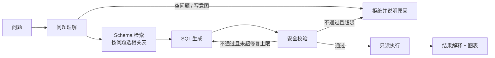

# LangGraph Text-to-SQL Agent

[](https://github.com/liuyusheng-ai/langgraph-text-to-sql-agent/actions/workflows/ci.yml)

面向结构化数据自助分析的 Text-to-SQL Agent：用户用自然语言提问，系统完成问题理解、Schema 检索、SQL 生成、安全校验、只读执行和结果解释，并返回图表配置和可复核的查询历史。

重点是**模型生成的 SQL 不可信**：每条 SQL 都要在服务端通过校验，执行时再由只读连接、行数上限和数据库级超时兜底。不依赖提示词作为防线。

## 评测结果

`python eval/run_eval.py` 离线运行，完整明细见 [eval/RESULTS.md](eval/RESULTS.md)。

| 类别 | 结果 |
| --- | --- |
| 正常查询结果正确（与参考 SQL 结果逐行比对） | 15/15 |
| 危险自然语言请求被拒绝（删除、修改、建表、授权、空问题等） | 10/10 |
| 对抗 SQL 被拦截（多语句、注释绕过、CTE 写操作、危险函数等） | 15/15 |
| 正常但易误判的 SQL 放行并执行（`REPLACE()`、字符串里的关键字等） | 8/8 |
| 端到端延迟 P50 / P95 | 0.72 ms / 0.89 ms |

正常查询使用规则版 SQL 生成器，所以这组数字证明的是**工作流与安全边界**，不代表大模型生成 SQL 的准确率；延迟也不含模型推理时间。

## 工作流



所有请求（包括被拒绝的）都写入查询历史，记录 SQL、状态、拒绝原因和耗时。

## 安全边界

| 层 | 做法 |
| --- | --- |
| 问题理解 | 空问题、超长问题、删除/修改/建表/授权类意图在生成 SQL 前直接拒绝 |
| SQL 校验 | 只允许一条 `SELECT` / `WITH`；先剥离字符串字面量和引号标识符再检查，避免把 `'update'` 或 `REPLACE()` 误判为写操作 |
| 禁止关键字 | `INSERT`、`UPDATE`、`DELETE`、`DROP`、`ALTER`、`CREATE`、`ATTACH`、`PRAGMA`、`INTO`、`REPLACE INTO` 等 |
| 禁止函数 | SQLite 的 `load_extension`、`readfile`、`randomblob` 等；PostgreSQL 的 `pg_sleep`、`pg_read_file`、`dblink` 等；MySQL 的 `sleep`、`benchmark`、`load_file` |
| 行数上限 | 把整条查询包进外层 `SELECT * FROM (...) LIMIT n`，内层或 CTE 自带的 `LIMIT` 无法绕过；取数时再用 `fetchmany` 兜底并标记截断 |
| 只读执行 | 生成的 SQL 走独立的连接；SQLite 连接开启 `query_only`，即使校验被绕过也无法写入 |
| 超时 | SQLite 用进度回调在数据库内部中止超时查询（递归 CTE 死循环也能停下），外层再有线程超时 |
| 修复次数 | 校验失败时把原因交给生成器重写，默认最多 1 次，防止无限重试 |

接入其他数据库时，仍应使用只读数据库账号，并在数据库侧设置语句超时。

## 快速开始

需要 Python 3.10+。

```bash
python -m venv .venv
source .venv/bin/activate          # Windows: .venv\Scripts\activate
pip install -r requirements.txt
uvicorn app:app --reload
```

打开 <http://127.0.0.1:8000/docs>：

```text
POST /api/query     {"question": "按产品类别统计销售额"}
GET  /api/history
GET  /healthz
```

可以试试“华东地区的订单明细”“销售额最高的产品是哪个”“查看月度销售趋势”，或者“删除全部销售数据”看拒绝效果。默认使用 SQLite 演示库，`DATABASE_URL` 可指向其他 SQLAlchemy 支持的数据库。

## 测试

```bash
pytest -q                 # 39 项：校验器拦截与误判、只读连接、超时中止、修复路径、Schema 检索、API
python eval/run_eval.py   # 48 条评测
```

CI 在 Python 3.10 / 3.11 / 3.12 上运行全部测试和评测。

## 目录

```text
sql_agent/
  workflow.py   LangGraph 六节点工作流与条件路由
  safety.py     SQL 校验：单语句、关键字、危险函数、行数上限
  database.py   只读执行、数据库级超时、Schema 检索、查询历史、演示数据
  llm.py        可替换的 SQL 生成器（离线规则实现）
  charting.py   Plotly 兼容图表配置
app.py          FastAPI 接口
eval/           评测用例、运行脚本与结果
tests/          自动化测试
```

## 局限

- `llm.py` 是规则版生成器，只覆盖演示数据上的常见问法；接入大模型只需实现 `generate(question, schema, error)`，生成结果照样要过校验。
- Schema 检索按表名、列名和中文别名做关键词匹配，适合小规模库；表多时应换成向量检索。
- 关键字校验是保守策略，个别合法写法（例如列名叫 `set`）会被拒绝，需要用引号包住。
